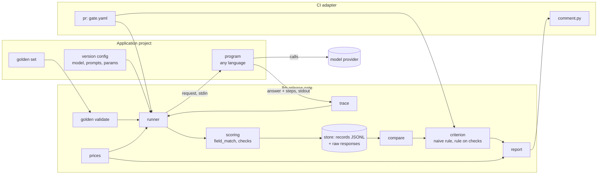
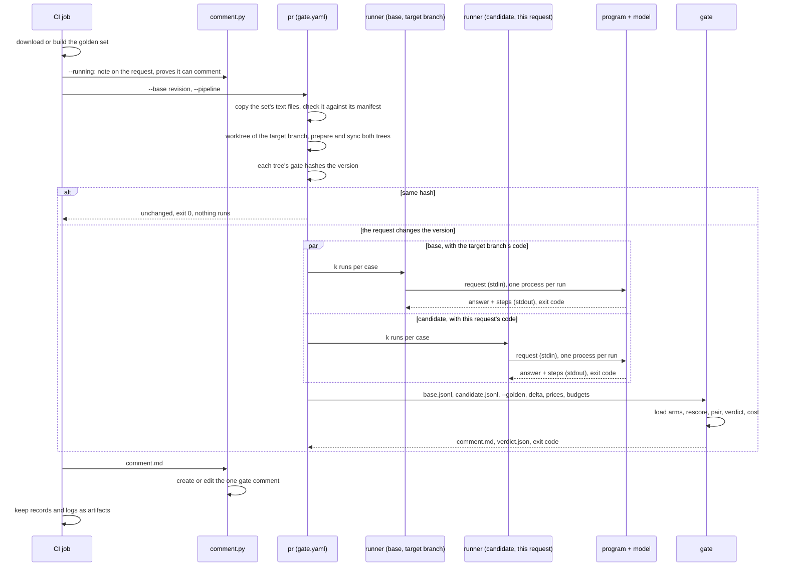

# Design

`llm-release-gate` runs the old and the new version of an LLM application on a fixed set of test cases in CI, compares
them case by case and returns a verdict that can block the merge. This document describes the parts, their interfaces,
the flow of a merge request and the record of a run. **Built** marks what the code does today; **planned** marks the
target architecture.

## Components

| Component | Module | Responsibility | Status |
|---|---|---|---|
| Pipeline interface | `pipeline.py`, `command.py` | what the gate knows about an application: cases in, answers out, one YAML config per version; any program as a pipeline | built |
| Golden set | `golden.py`, `case.schema.json`, `hashing.py` | test cases on disk, validated, hashed | built |
| Runner | `runner.py` | runs a version K times per case, in parallel, with retries and resume | built |
| Store | `runner.py` (`read_records`, `results`) | append-only JSONL records, raw provider responses next to them | built |
| Trace | `trace.py` | the steps inside one run: model calls, tool calls, messages, final state | built |
| Scoring | `metrics.py`, `checks.py` | turns an answer and its trace into per-check results and a case score | built |
| Prices | `prices.py` | list prices per model prefix, cached input included | built |
| Comparison | `compare.py` | pairs the records of two versions case by case, refuses what cannot be compared | built |
| Criterion | `gate.py`, `criterion.py` | the verdict and its exit code | built (naive rule; betting rule on the mean with inconclusive; the rule on checks with levels) |
| Budget | `budget.py`, `gate.py` | cost of the decision; cost and latency limits | built |
| Report and comment | `gate.py`, `comment.py` | Markdown and JSON verdict; one comment on the pull or merge request, edited on later pushes | built |
| CI adapter | `action.yml`, `setup/action.yml`, `project.py` (`gate.yaml`), `pr.py`, `comment.py`, `cli.py` | runs both versions of each changed pipeline of a request and posts the verdict | built (a GitHub Action; `llm-release-gate` for any CI) |
| Shared runs | `pr.py` (`--cache`, `--refresh`), `shared.py` | a version's runs outlive the job: the base's recent runs come from earlier jobs (D-007) | built (a directory any CI keeps; GitHub artifacts) |
| Dashboard | `dashboard/` (Next.js) | the gate's runs per repository: history of pull requests, a run's cases, a case's answers, checks and steps on both sides | built (first version) |

Projects use the gate as a dependency, each in its own repository: [receipt-intake](https://github.com/Ilya-Grigoryev/receipt-intake) (receipt
extraction from OCR text or a scan, in one model call or two), [workbench-support](https://github.com/Ilya-Grigoryev/workbench-support) (a tool-using
agent over a booking system, alone on a ticket or in a chat with a simulated user) and
[telecom-support](https://github.com/Ilya-Grigoryev/telecom-support) (tau2-bench's telecom agent, tools, tasks and evaluator, unchanged).

### Pipeline interface (built)

- **Case** (`Case`): `id`, `inputs` (name → file path), `expected` values, `scoring` block.
- **Answer** (`Answer`): `output` (parsed), `raw`, `input_tokens`, `output_tokens`, `latency_s`, `model` (as the provider
  reported it), `fingerprint`, `reasoning_tokens`, `finish_reason`, `request_id`.
- **Pipeline**: the program the version's config names (`command.Command`; its `run(case) -> Answer` raises `Retryable`
  when the same run may succeed later and `Fatal` when no run can). The gate imports no application code (only a
  `function` check's module); it starts the program, in any language, once per run.
- **Version** (`PipelineConfig`, `load_config(path)`): `command`, `model`, `prompt` (a file or named files), `input`,
  `params`, `max_retries`, `timeout_s`. `config_hash(config)` covers every field
  and the bytes of each prompt file; `version.version_hash(path)` adds the repository's code (D-025): every tracked file
  by the id git gives its content (the index's id, or the id of a modified file on disk), but documentation, CI,
  `gate.yaml` and its price files, its `ignore`, its test sets and its other pipelines' files.
  Records carry it as `config_hash`, so resuming, pairing, the dashboard and `unchanged` share one notion of a version.
- **Protocol** (`command: [program, args]`; [protocol.md](protocol.md), `protocol.schema.json`): one JSON request on stdin (case id, input paths, the
  version; never the expected values), one JSON answer on stdout (`output`, optionally tokens, model, the provider's
  fingerprint, finish reason and request id, and a trace). Exit 75
  and a timeout retry; 78, 126, 127 and a program that cannot start stop the run; any other non-zero code fails the run.
  A trace printed before a failed exit is kept. On timeout the gate kills the program's process group (POSIX) and that
  attempt's trace is lost.
- **Model names.** A dated snapshot when there is one. One name is one model (D-029), with or without a date. For a
  name without a date (`is_alias(model)`) the record keeps the requested and the reported model, the report warns, and
  comparison refuses runs that asked for the same model and got different ones or did not say which one they got.

### Golden set (built)

One YAML file per case, inputs referenced by path relative to it. `validate(directory) -> (set_hash | None, errors)`
checks the schema, unique ids, that inputs exist inside the set, and each scoring block (`metrics.problems(expected,
scoring)`, which checks a `checks` configuration against the case's expected values without running it).
`load_cases(directory) -> list[Case]`. The **set hash** (`hashing.canonical_hash`, `file_hash`) covers each case's parsed
content and the bytes of each input: reformatting keeps it, editing an expectation or an input changes it.
`python -m llm_release_gate.golden validate DIR [--manifest FILE]` also checks the ids and the hash against a manifest.

### Runner (built)

`run(pipeline, cases, repetitions, out, *, config_hash, set_hash, score, workers=4, max_retries=5, wait=None,
prices=None, model=None) -> records written`; CLI: `python -m llm_release_gate.runner --config FILE --golden DIR -k K
--out FILE [--workers N] [--prices FILE]`.

- It runs the missing (case, repetition) pairs on a thread pool.
- It retries `Retryable` with backoff 1, 2, 4… s (at most 60 s) up to `max_retries`, stops the run on `Fatal`, and records
  any other exception as an error of that run.
- It keeps one `Trace` per pair, current while the program runs (a context variable, one per worker thread). A retried
  run adds its steps under the next `run_attempt`; a failed run keeps the steps it paid for (a `Fatal` one too, when it
  paid for any).
- It scores each answer with the case's scoring block and the run's trace (as JSON brings it back, so rescoring later
  gives the same result) and appends one record per run.

### Store (built)

Records are JSON lines appended to `out`; raw provider responses would go to `<stem>.native.jsonl` next to it
(`runs.jsonl` → `runs.native.jsonl`), written before the record that points to them; nothing records them since programs
report their own steps, until the planned proxy. `read_records(path)` skips a line cut off by a
crash; `results(path, config_hash, set_hash)` gives the last error-free record per (case, repetition), which is what
makes a rerun pay only for the rest.

### Trace (built)

The program reports its steps and end state in the answer's `trace`; `command.record` copies them into the current
trace, also from an answer printed before a failed exit:

- `current() -> Trace | None` is the trace of the run in progress on this thread (None outside the runner).
- `Trace.step(kind, actor, **fields)` adds a step, numbers it (`seq`, `run_attempt`) and refuses one that breaks the
  format.
- `usage(trace, prices, reprice=False)` sums calls, tokens and cost per actor over every answered call, abandoned attempts
  included; `last_attempt(trace)` gives the steps of the final attempt, which checks look at.

### Scoring (built)

`score(expected, actual, scoring, trace=None) -> {"score": float | None, "per_field": {id: bool | float | None}}`; the
runner's scorer is `hits(case, answer, trace=None)` (by default the run's trace, taken from the runner), with `hits.version` stored in each record.

- `scoring.method` picks the scorer: `field_match` (each expected field against the answer; dates and numbers by value,
  strings after normalisers; a field expected as `null` is not scored) or `checks` (a list of checks).
- Checks over the answer: `field_match`, `exact`, `contains`, `regex`, `number`, `json_schema`, `refusal`. Over the trace:
  `called`, `not_called`, `order`, `max_steps`, `active`, `actions`, `state`, `doc_found`. Plus `function`
  (`module:function`). Step checks look at the last attempt and one actor; `state` reads `final_state` and
  `state_change`. Without a trace they fail (`doc_found` with no ids expected is not scored).
- `aggregate` turns per-check results into the case score: `mean` (default) or `all` (1 only if every scored result is
  full). The record keeps every result.
- Runs scored by different scorer versions are compared only after rescoring from their saved answers (`gate --golden`).

### Comparison and criterion

- `load_arm(path) -> Arm` reads one version's runs: one config, one set, one scorer, the last error-free record per pair;
  `Arm` holds `config_hash`, `set_hash`, `scorer_version`, `records`, `aliases`.
- `pair(base, candidate) -> {case: (base records, candidate records)}` refuses different sets or scorers, cases on one side
  only, and, for a model without a date, runs whose provider reported different models (or none).
- **Built — naive rule.** `naive(base, candidate, threshold_pp, relative=False) -> Verdict`, a pure function over one
  score per case and version (the CLI passes the earliest repetition): block when the candidate's mean is lower than the
  base's by more than the threshold (absolute or relative; the CLI's default is 5 points). Means are compared as exact fractions. `Verdict` holds
  `outcome`, `exit_code`, `base_mean`, `candidate_mean`, `diff_pp`, `limit_pp`, `rule`, `cases` and the cases that got
  worse. It gives `pass` (0) or `quality fail` (10); a budget can turn a pass into `budget fail` (12); `inconclusive` (11)
  comes from the betting rule; `infra error` (20) is any failure to compare.
- **Built — betting rule on the mean** (`mean.py`, `mean: betting`). The rule pairs run k of each case with run k of
  the base; D = candidate − base in [−1, 1] and Y = (D + 1) / 2. Two one-sided betting tests (Waudby-Smith and Ramdas,
  arXiv:2010.09686): capital K+ = Π (1 + λ (Y − m)) at m = (1 − δ) / 2 passes once it reaches 1 / α, K− = Π (1 − λ (Y − m))
  blocks; with independent calls Ville's inequality bounds each error at α (the rule's share of `alpha`: 0.025 by
  default, 0.05 when no check can block) over any number of looks at the same
  runs, so `run -k` can append runs outside CI and the rule decides again over all of them (experiment E-006: noise shared
  by a whole run breaks the bound). A new CI job runs the candidate afresh: it is a new test, not another look. The bet λ is the paper's predictable plug-in, truncated at c / m and c / (1 − m); it stays fixed for all
  cases of a run, which keeps the capital a supermartingale although cases have different means (AM–GM over the run).
  The first look is after 2 runs; the first look at which a side reaches 1 / α decides, block on a tie. `decide(base,
  candidate, delta, alpha, unit, bet, c, min_runs) -> MeanVerdict` also gives bounds on the difference at the look that
  decided (else the last), the number of paired case runs that differ, a 95 % normal range over cases for the report,
  `worse` (a pass shown worse than the base: the comment warns) and `runs_for_pass`, the runs of each version a
  candidate identical to the base needs; the comment turns the runs still missing into dollars at this decision's cost per
  run. Variants (`--mean NAME`): bets on whole runs and an empirical-Bernstein process, for the experiments.
- **Built — levels** (`levels.py`, `levels:` in `gate.yaml`). Each (case, check) is `critical`, `normal` or `minor`: the
  case is `minor`; else the check's pattern (`critical` first); else the case's pattern; else `normal`. The checks that
  may block (`critical`, and `normal` under `checks: block`) form one family for `per_check`; those that only report
  (`minor`, and `normal` under `checks: report`) another, each at half of `alpha`; the second never blocks and spends
  none of the gate's bound. A broken `critical` check leads the comment; a
  significantly worse check of the second family puts ⚠️ in the title ("minor" when all are minor, else "reported"), a
  `warnings` entry in the JSON and a `::warning` annotation in GitHub Actions, and keeps the exit code. Without `levels`,
  `checks: report` keeps its old output, with no ⚠️. `minor` checks leave the case score (rebuilt from `hits` with the case's own
  aggregate, so the scorer version stays), and a case with only `minor` checks leaves the mean. Without `levels`
  everything is `normal` and the gate is unchanged.
- **Built — the rule on checks.** `per_check(base, candidate, alpha, sides, mode,
  threshold) -> CheckVerdict`, a pure function over the results of each (case, check) per repetition: Fisher's exact test
  on k of K passes in each version, computed in exact fractions; Tarone's correction (only checks that could reach
  significance count, m the smallest number with at most m of them) and Bonferroni over those; a two-sided test blocks
  only a check that got worse; a share passes at `threshold`, None is left out; `block` or `report` mode. Defaults —
  one-sided, alpha 0.025 (the gate passes half its `alpha`) — wait on D-003's open choice (M-12); the list by a discrete BH is not built. The gate builds
  its input from every run's `hits` (`check_runs`; a run without results gives None) and turns a pass into `quality fail`
  when it blocks; `checks: report` in `gate.yaml` only lists. `can_block(kb, kc, alpha, sides)` says whether one check that
  broke in every run could block with these run counts, `runs_to_block(alpha, sides)` the fewest equal runs from which
  it can, 4 at the defaults; the comment names it when no break can be significant at α / m. Tarone's correction counts every
  check that could show a break, so several broken at once need more runs than one.
- **Built — one `alpha` for the gate** (`split`, `alpha:` in `gate.yaml`, `--alpha`). Either rule can block on its
  own, so the bound on a false block of the gate is the sum of theirs. `alpha` (default 0.05) is that sum: half to the
  betting rule, half to the rule on checks; all to the betting rule when the set has no check that may block. The
  settings and the set decide which checks may block, the results never do, so the split keeps the bound. The
  naive rule has no bound; under it `alpha` covers the rule on checks. The betting rule's share also bounds its wrong
  pass. The comment states the split (`alpha_line`); `pr` warns before the runs when `k` is below `runs_to_block` at
  the checks' share.
- **Built (D-032).** With `max_spend_usd` the gate buys rounds (`gate.plan`) until it decides or the next round does not
  fit, reads the checks once on rounds 1 to K_c (`gate.k_c`, `gate.look`), and a re-run continues with the request's
  own pairs of runs (`pr.resume`, `pinned.jsonl`, the cache's `-met-` files).
- **Planned.** A second comparison against an
  anchor version, so that many small losses cannot add up unseen;
  an adaptive runner that pays for repeated runs only where the versions disagree. Each takes a seed as an argument and
  reports it in the verdict.

### Budget, report and comment

- **Built.** `cost(arm, prices) -> float | None`: a traced record costs what its model steps cost at the gate's prices (the
  user simulator's included: it is the price of the decision); a record with no model steps in its trace is priced
  from its tokens and reported model.
  `markdown(verdict, base, candidate, costs)` writes the verdict, the two means, the rule, the cases, the configs, the
  set, how many base runs came from earlier jobs, the cost, the warning about models without a date and the cases that
  got worse; the JSON report holds the verdict's fields plus the threshold, both config hashes, the set hash, the scorer
  version, whether it rescored, the cost, the hash of the price table, the budget, `models_without_date`, the runs per
  case and `base_reused`. `cost` leaves out runs marked `reused`: the cost counts what this job paid. CLI: `python -m
  llm_release_gate.gate (--base FILE | --no-base) --candidate FILE [--threshold PP] [--relative] [--mean RULE] [--checks MODE]
  [--levels JSON] [--golden DIR] [--prices FILE]
  [--max-cost-per-run USD] [--max-latency S] [--latency-quantile Q] [--markdown FILE] [--json FILE]`; the exit code is
  the verdict's. `comment.py` posts the Markdown as one comment on a GitHub pull request or GitLab merge request, edits it on
  later pushes, and posts an infra-error comment when the job stopped before a verdict. CLI: `python -m
  llm_release_gate.comment [FILE] [--name NAME] [--running] [--project DIR] [--check] [--dry-run]`; it needs `GITHUB_TOKEN` with `pull-requests: write` or
  `GITLAB_TOKEN` with scope `api`.
- **Built — budgets.** `budget.check(costs, latencies, retried, cost_limit, latency_limit, latency_q, level) -> Budget`, a
  pure function over the candidate's runs: the mean cost per run against its limit; a latency quantile with a
  distribution-free interval from order statistics (`quantile_ci`), over only when the interval's lower end exceeds the
  limit. A run's latency is the answering attempt's `latency_s`; runs with retries are counted apart. `Budget` holds the
  outcome, the limits exceeded, the estimates, the interval and the limits. The gate turns a pass into `budget fail` (12);
  quality comes first. CLI: `--max-cost-per-run USD` (needs `--prices`), `--max-latency S`, `--latency-quantile Q`.
- **Planned.** A JUnit report.

### CI adapter (built)

A project says what to gate in `gate.yaml` (`project.schema.json`, `project.load`): named pipelines, each a version's
config and a golden set (with an optional manifest and `inputs-url`), and the settings `k`, `delta`, `alpha`, `mean`, `checks`, `levels`, `prices`,
`budgets`, `base_max_age_hours` and `max_spend_usd`, which a pipeline may override, plus a `prepare` command. Its pull request job (on GitHub: `uses:
Ilya-Grigoryev/llm-release-gate@<tag>` after its `setup` action) gets the golden set (from
the repository, a GitHub release or a GitLab package; on GitHub in a step before the action), comments that it is running
with the number of cases (proving it can comment), then runs `llm-release-gate pr --base REV --out OUT` from the
repository's root. For each pipeline `pr` first copies the golden set's text files (cases and text inputs, never
images; links followed) to `OUT/NAME/cases`, so even a run without a verdict shows what it was given, and checks the set
against its manifest. It checks out the target branch in a worktree, runs `prepare` and syncs the environment in both
trees, and asks each tree's own gate for the version's hash. The rules (`delta`, `alpha`, `k`, `mean`, `checks`, `levels`, `budgets`, `prices`,
`base_max_age_hours`, `max_spend_usd`) come
from the target branch's `gate.yaml` when it has one (D-024); price files are copied before the request's `prepare`
runs in that tree. Pipelines are matched by name, and the base arm runs the target branch's config of the pipeline, so
renaming a config file keeps the base. A pipeline the target branch lacks gives `no base version`: only the candidate
runs (`gate --no-base`), for its score and budget, exit 0. The comment notes changed rules, a new pipeline and a changed
test set. The gate runs the request's code, workflow and lock file: it catches mistakes, not a hostile author. Equal hashes give `unchanged` (exit 0, no runs) when the two `gate.yaml` agree on `ignore` and on which files belong to which pipeline; a request that removes a pipeline exits 11;
otherwise both versions run in parallel, each with its own code, `k` runs per case, and the gate writes `comment.md` and
`verdict.json`. With `--cache DIR` the base's runs come from earlier jobs first (below). A step that cannot run gives an infra-error comment and 20; `pr` exits with the worst outcome of its
pipelines. The action gates one pipeline per step (`pipeline:`, or the only one), posts the comment and keeps the
records as an artifact (`release-gate-NAME-ATTEMPT`) and the text files as a second one (`…-cases`, 30 days). It
advises: on GitHub until the check is made required, on GitLab while the job has `allow_failure: true`. On a pull
request from a fork GitHub passes no secrets: the action runs nothing and fails as `not checked`, so a required check
never passes an unchecked request.

**Shared runs** (D-007). A version is the same in any commit (config, prompts, tracked code), so the gate runs it once.
With `base_max_age_hours` above 0 (default 0, D-033: the base runs next to the candidate in every job),
`pr --cache DIR` keeps each version's error-free runs in `DIR/NAME/VERSION-SET.jsonl` (per case and repetition the run
kept first stays until it is older than the limit; raw responses next to them) and, before running the base, copies
that version's runs on that set into `base.jsonl`, the first `k` per case and at most that many hours old, each marked
`reused`; the runner
then runs only what is missing. On GitHub the directory starts empty: `shared.fetch` asks the REST API for the newest
artifact `llm-release-gate-runs-NAME-VERSION16-SET16` of this repository's own runs (not a fork's) within the age limit,
downloads it (the redirect to storage gets no token) and adds its runs to the directory; `pr` names the versions this
job paid for in `OUT/NAME/shared.txt`, and the action uploads them under that name. A merged request's candidate is the
target branch's new version when the merge keeps the tree, so the next request usually finds its base run. Reuse never
fails a check: any error there runs the base, and a cached record with malformed ids or model names is skipped. The gate skips reuse when the
request changes `prepare` and when the target branch has no valid `gate.yaml` (a model without a date is cached too,
D-029); it needs `actions:
read`, and without it the comment says so. The verdict counts the cost
of the runs this job paid for and reports `base_reused` (how many, how much older than the candidate). `pr --refresh`
runs the default branch's version on a push, a manual run or a schedule, for later requests; it reuses recent runs too,
so a drift series needs a separate job. The price of reuse:
drift at the provider within the age limit counts as an effect, and all requests in the window share one base sample,
so their verdicts are not independent (`base_max_age_hours: 0`, the default, for experiments that count errors). The environment of a
request's workflow is not part of the version.

### Dashboard (built, first version)

A web app in `dashboard/` (Next.js, on Vercel), with its own README. A GitHub App installed on a project's repositories
receives `workflow_run`; when a run finishes, the app downloads its `release-gate*` artifacts and stores one row per
artifact in Postgres: the run's metadata, the verdict, the comment and the records the gate compared (the last
error-free one per case and repetition, as the gate reads them). Installing the App reads the runs among the
repository's 1,000 newest artifacts; the project's workflow needs no change and no secret. Signing in goes through the
same App, so a user sees the repositories where it is installed and they have access on GitHub. Pages: the projects; a
project's runs over time (base and candidate mean per run, same-version runs marked); a run's verdict and its cases,
changed ones first; a case's answer, checks and steps on both sides.

## Merge request flow

## The record of a run

One JSON line per (case, repetition), record version 6:

| Field | Meaning |
|---|---|
| `record_version` | format of the record |
| `config_hash`, `set_hash` | the version (config, prompts, code) and the test set; runs on different sets are never paired |
| `commit` | the project's commit, `+dirty` with uncommitted edits; to find the code, not to compare |
| `case`, `rep`, `run_id`, `timestamp` | which run, of which invocation, when (UTC) |
| `requested_model` | the model the config asked for |
| `prices_hash` | hash of the price table the runner priced `usage` with, `null` without one |
| `output`, `raw`, `input_tokens`, `output_tokens`, `latency_s`, `model`, `fingerprint`, `reasoning_tokens`, `finish_reason`, `request_id` | the pipeline's `Answer`; `model` is what the provider reported |
| `wall_s` | clock time of the run, backoff between attempts included |
| `trace` | the steps of the run, or `null` for a pipeline that records none |
| `usage` | calls, tokens and cost per actor (`agent`, `user`) from the trace; `usage_error` if a step could not be summed |
| `scorer_version`, `hits`, `score`, `score_error` | per-check results, the case score, a scoring failure |
| `retries`, `error` | backoffs used; why the run produced no answer (`null` when it did) |
| `reused` | `true` on a base run copied from an earlier job (`pr --cache`); missing otherwise |

The trace:

| Field | Meaning |
|---|---|
| `v` | format of the trace |
| `steps` | ordered steps, each with `seq`, `kind` (`llm`, `tool`, `message`, `retrieval`), `actor` (`agent`, `user`, `system`, `env`), `ts` (`null` for a tool step restored from a model's call), `run_attempt` |
| — model step | `status`; when `ok`: `model`, `tokens_in`, `tokens_out`, `tokens_cached`, `tokens_reasoning`, `cost_usd`, `finish_reason`, `fingerprint`, `request_id`, `text`, `tool_calls` (`id`, `name`, `args`), `latency_ms`, `purpose` (set by the program, e.g. `compaction`, not counted by `max_steps`); when `error`: `error`, `attempt`, `latency_ms` |
| — tool step | `name`, `args`, `status` (`ok`, `error`, `unknown`), `result` or `error`, `call_id`, `latency_ms` |
| — retrieval step | `docs` with `id` (what `doc_found` reads) |
| `final_state`, `state_change` | the world after the run and what changed, as the program reports them |
| `stop` | why the run ended, as the program says: `done`, `user_stop`, `max_steps`, `max_turns`, `error`, `aborted`; the runner sets `error` on a failed run with steps and no `stop`. The gate does not check the value |
| `last_attempt` | the number of the runner's final attempt; checks look at its steps |
| `notes` | what went unrecorded, and why |
| `native` | the file with the raw provider responses |

Any step may carry `extra` for what the format does not name. Only new model output is stored, not the full prompt of each
call: the system prompt and the tools are part of the version (and its hash), and full prompts would grow the records
about 25-fold for a long dialog.

## Invariants

- A pipeline stays behind its interface; changing it does not touch the gate's code.
- Criteria and budget checks are pure functions: arrays of results in, a verdict out; no network, files, clock or logs. A
  seed comes in as an argument and goes into the verdict.
- Every record carries the version's hash (config, prompts, code) and the set hash; runs on different sets are not compared.
- The runner resumes after a crash and runs cases in parallel with a limit and backoff.
- "Quality failed" and "tool crashed" are different exit codes.

## Planned

- **Statistical gate** (see Criterion), interleaved arms in the runner, latency budgets, the anchor comparison; more
  base runs than candidate runs, paid once and shared through the reused runs.
- **Adoption** (D-023): the protocol's schema for any program (built), `gate.yaml` and `llm-release-gate pr` (built), a
  verdict without a base version and forks (built), a maintainer's run of a fork's request, one way to connect for every language (built: no Python adapters), the engine through `uvx`, `init` and
  `doctor`, a recording proxy for traces, a GitLab component and a pytest plugin; a JUnit report.
- **Programs**: a benchmark program (τ²-bench telecom), a harness agent in a container through `command`,
  retrieval-augmented generation (to be decided), import of OpenTelemetry traces.
- **Dashboard**: the main branch's mean with the anchor line, why a verdict passed or blocked (with its interval), noise
  per case and check, cost and time against the budget, a diff of config and prompt, a demo without signing in.
