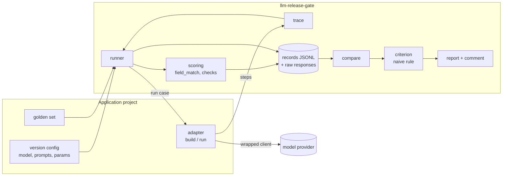
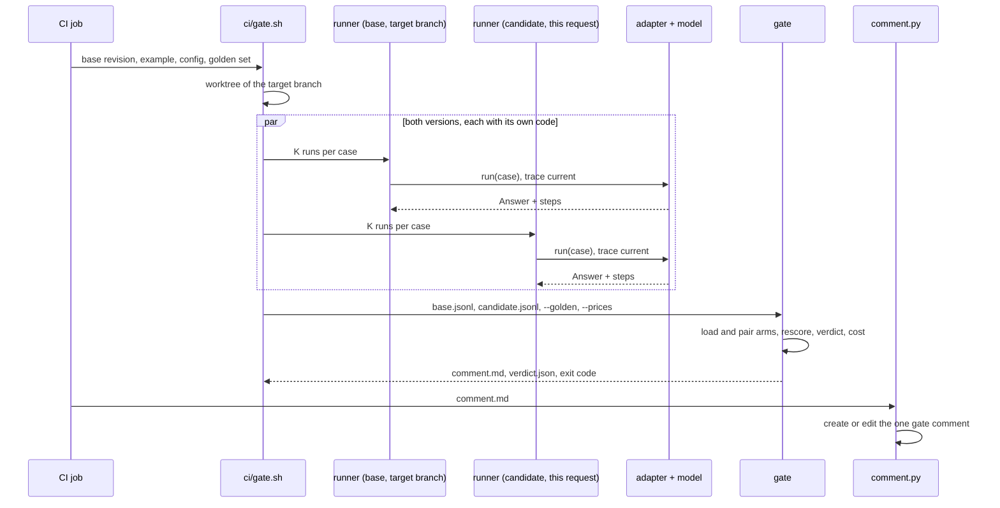

# Design

`llm-release-gate` runs the old and the new version of an LLM application on a fixed set of test cases in CI, compares
them case by case and returns a verdict that can block the merge. This document describes the parts, their interfaces,
the flow of a merge request and the record of a run. **Built** marks what the code does today; **planned** marks the
target architecture.

## Components

| Component | Module | Responsibility | Status |
|---|---|---|---|
| Pipeline interface | `pipeline.py` | what the gate knows about an application: cases in, answers out, one YAML config per version | built |
| Golden set | `golden.py`, `case.schema.json` | test cases on disk, validated, hashed | built |
| Runner | `runner.py` | runs a version K times per case, in parallel, with retries and resume; writes one record per run | built |
| Trace | `trace.py` | the steps inside one run: model calls, tool calls, messages, final state | built |
| Scoring | `metrics.py`, `checks.py` | turns an answer and its trace into per-check results and a case score | built |
| Prices | `prices.py` | list prices per model prefix, cached input included | built |
| Comparison | `compare.py` | pairs the records of two versions case by case, refuses what cannot be compared | built |
| Criterion | `gate.py` | the verdict: pass, quality fail, inconclusive, budget fail, infra error | built (naive rule); planned (statistical rules) |
| Budget | `gate.py` | cost of the decision from the records; cost and latency limits | built (cost report); planned (limits) |
| Report and comment | `gate.py`, `comment.py` | Markdown and JSON verdict; one comment on the pull or merge request, edited on later pushes | built |
| CI adapter | `ci/gate.sh`, `.github/workflows/ci.yml`, `.gitlab-ci.yml` | runs both versions of a request and posts the verdict | built (this repository); planned (reusable action and template) |
| Dashboard | — | history of merge requests, base against candidate down to a trace step | planned |

### Pipeline interface (built)

- A **case** (`Case`): `id`, `inputs` (name → file path), `expected` values and a `scoring` block.
- An **answer** (`Answer`): the parsed `output`, the `raw` text, input and output tokens, latency, the model the provider
  reported, fingerprint, reasoning tokens, finish reason, request id.
- A **pipeline** is any module with `build(config) -> obj` where `obj.run(case) -> Answer`. It raises `Retryable` when the
  same call may succeed later and `Fatal` when no call can. The gate's code imports no pipeline; the config names it by
  import path.
- A **version** is a YAML config (`PipelineConfig`): pipeline module, model, prompt file or named prompt files, input,
  API parameters, `max_retries`, `timeout_s`. Its **config hash** covers every field, the bytes of each prompt file and the
  module's `VERSION`.
- A model is a dated snapshot when there is one. A name without a date is accepted (`is_alias`) with three precautions:
  the record keeps the requested and the reported model and the time, the report warns, and comparison refuses runs with
  a pause longer than an hour or with different reported models.

### Golden set (built)

One YAML file per case, inputs referenced by path relative to it. `validate(directory)` checks the schema, unique ids,
that inputs exist inside the set, and each scoring block (`metrics.problems`, which checks a `checks` configuration
against the case's expected values without running it). The **set hash** covers each case's parsed content and the bytes
of each input: reformatting keeps it, editing an expectation or an input changes it.

### Runner (built)

`run(pipeline, cases, repetitions, out, config_hash, set_hash, score, workers, max_retries, wait, prices, model)`:

- runs the missing (case, repetition) pairs on a thread pool; a pair with an error-free record for the same config and set
  hash counts as done, so a rerun pays only for the rest;
- retries `Retryable` with backoff 1, 2, 4… s up to `max_retries`, stops the run on `Fatal`, records any other exception
  as an error of that run;
- keeps one `Trace` per pair, current while the pipeline runs (a context variable, one per worker thread); a retried run
  adds its steps under the next `run_attempt`; a failed run keeps the steps it paid for;
- scores each answer with the case's scoring block and the run's trace, and appends one JSON record per run to `out`; raw
  provider responses go to `<out>.native.jsonl`.

### Trace (built)

An adapter records into the current trace without touching the application:

- `openai_client(client, actor)` wraps `chat.completions.create`: one model step per call; tool steps are rebuilt from the
  `tool` messages the application sends back (status `unknown`); a failed call is a step with `status: error`; a streamed
  call leaves a note;
- `wrap_tool(call, actor)` wraps a tool function `call(name, args)`: one tool step per call with status, result or error
  and timing;
- `Trace.step(kind, actor, **fields)` records anything else; the adapter sets `final_state`, `state_change` and `stop`.

`usage(trace, prices)` sums calls, tokens and cost per actor over every answered call, abandoned attempts included;
`last_attempt(trace)` gives the steps that checks look at.

### Scoring (built)

The case's `scoring.method` picks the scorer, and `aggregate` (`mean` or `all`) turns per-check results into the case
score; the record keeps every result.

- `field_match`: each expected field against the answer; dates and numbers by value, strings after normalisers; a field
  expected as `null` is not scored.
- `checks`: a list of checks over the answer (`field_match`, `exact`, `contains`, `regex`, `number`, `json_schema`,
  `refusal`) and over the trace (`called`, `not_called`, `order`, `max_steps`, `active`, `actions`, `state`, `doc_found`),
  plus `function` (`module:function`). Trace checks look at the runner's last attempt and one actor, and fail without a
  trace.

Records carry the scorer version; runs scored by different versions are compared only after rescoring from their saved
answers (`gate --golden`).

### Comparison and criterion

`load_arm(path)` reads one version's runs (one config, one set, one scorer; the last error-free record per pair).
`pair(base, candidate)` refuses different sets or scorers, cases on one side only, and, for a model without a date, runs
that are not close in time.

- **Built — naive rule.** One run per case and version (the earliest repetition): block when the candidate's mean score
  is lower than the base's by more than a threshold (5 points by default, absolute or relative). Means are compared as
  exact fractions.
- **Planned — statistical rules.** A paired test on the mean with a margin δ and three outcomes (pass, block, buy more
  runs and leave it to a human); a per-check test that blocks a check that breaks consistently, with a correction for
  multiple comparisons; a second comparison against an anchor version, so that many small losses cannot add up unseen;
  an adaptive runner that pays for repeated runs only where the versions disagree.

### Budget, report and comment

- **Built.** `cost(arm, prices)`: a traced record costs what its model steps cost at the gate's prices (the user
  simulator's included: it is the price of the decision); a record without a trace is priced from its tokens.
  `markdown()` writes the verdict, the two means, the rule, the cases, the configs, the set, the cost and the cases that
  got worse; the JSON report holds the same plus the thresholds and the models without a date. `comment.py` posts the
  Markdown as one comment on a GitHub pull request or GitLab merge request and edits it on later pushes.
- **Planned.** Cost and latency limits that give `budget fail`; a latency quantile with an interval.

### CI adapter (built for this repository)

`ci/gate.sh BASE_REV EXAMPLE_DIR CONFIG GOLDEN_DIR OUT_DIR` checks out the target branch in a worktree, runs both versions
in parallel, each with its own code, runs the gate and writes `comment.md` and `verdict.json`. It exits with the gate's
code: 0 pass, 10 quality fail, 11 inconclusive, 12 budget fail, 20 infra error. The job advises until the check is made
required.

## Merge request flow

## The record of a run

One JSON line per (case, repetition), record version 4:

| Field | Meaning |
|---|---|
| `record_version` | format of the record |
| `config_hash`, `set_hash` | the version and the test set; runs on different sets are never paired |
| `case`, `rep`, `run_id`, `timestamp` | which run, of which invocation, when (UTC) |
| `requested_model` | the model the config asked for |
| `output`, `raw`, `input_tokens`, `output_tokens`, `latency_s`, `model`, `fingerprint`, `reasoning_tokens`, `finish_reason`, `request_id` | the pipeline's `Answer`; `model` is what the provider reported |
| `wall_s` | clock time of the run, backoff between attempts included |
| `trace` | the steps of the run, or `null` for a pipeline that records none |
| `usage` | calls, tokens and cost per actor (`agent`, `user`) from the trace |
| `scorer_version`, `hits`, `score`, `score_error` | per-check results, the case score, a scoring failure |
| `retries`, `error` | backoffs used; why the run produced no answer (`null` when it did) |

The trace:

| Field | Meaning |
|---|---|
| `v` | format of the trace |
| `steps` | ordered steps: `seq`, `kind` (`llm`, `tool`, `message`, `retrieval`), `actor` (`agent`, `user`, `system`, `env`), `ts`, `run_attempt`; a model step adds `status`, `model`, `tokens_in`, `tokens_out`, `tokens_cached`, `tokens_reasoning`, `cost_usd`, `finish_reason`, `text`, `tool_calls`; a tool step adds `name`, `args`, `status` (`ok`, `error`, `unknown`), `result` or `error`, `call_id`, `latency_ms` |
| `final_state`, `state_change` | the world after the run and what changed, as the adapter reports them |
| `stop` | why the run ended: `done`, `user_stop`, `max_steps`, `max_turns`, `error`, `aborted` |
| `last_attempt` | the runner's final attempt: the steps checks look at |
| `notes` | calls that went unrecorded, and why |
| `native` | the file with the raw provider responses |

Only new model output is stored, not the full prompt of each call: the system prompt and the tools are part of the version
(and its hash), and full prompts would grow the records about 25-fold for a long dialog.

## Invariants

- A pipeline stays behind its interface; changing it does not touch the gate's code.
- Criteria and budget checks are pure functions: arrays of results in, a verdict out; no network, files, clock or logs.
- Every record carries the config hash and the set hash; runs on different sets are not compared.
- The runner resumes after a crash and runs cases in parallel with a limit and backoff.
- "Quality failed" and "tool crashed" are different exit codes.

## Planned

- **Statistical gate** (see Criterion), interleaved arms in the runner, latency budgets, the anchor comparison.
- **Adoption**: a `gate.yaml` at the root of an application project, a `pr` command that runs only the versions whose
  config hash changed, a reusable GitHub Action and GitLab template.
- **Adapters**: any command speaking JSON on stdin and stdout (applications in other languages, a harness agent in a
  container), a benchmark adapter (τ²-bench telecom), import of OpenTelemetry traces.
- **Dashboard**: a server with the history of merge requests and the base against the candidate down to a trace step.
